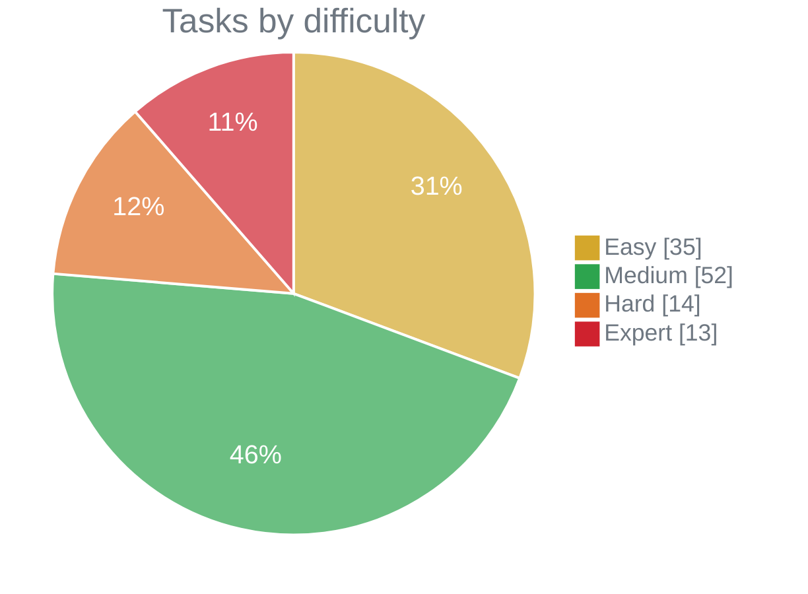
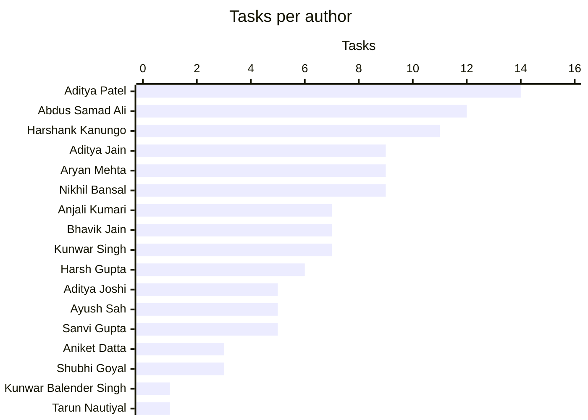

# Anubis Stage 2

<!-- STATS:START -->
<!-- Generated by .github/scripts/generate_readme.py on every push to main. Do not edit by hand. -->
Benchmark tasks for evaluating agents on realistic **data processing**, **software engineering**, **debugging** and **scientific computing** work, each packaged with its environment, reference solution, tests and recorded model trajectories.

   

> Difficulty is computed from each task's recorded Opus `run_1` reward (0–1) in `trajectories/<model>/run_1/verifier/reward.json`:<br>
> ⚪ Trivial 87.5–100% · 🟢 Easy 50–87.5% · 🟡 Medium 37.5–50% · 🟠 Hard 25–37.5% · 🔴 Expert 0–25%

## Summary

| Difficulty | Score range | Tasks |
|---|:-:|--:|
| ⚪ Trivial | 87.5–100% | **0** |
| 🟢 Easy | 50–87.5% | **35** |
| 🟡 Medium | 37.5–50% | **52** |
| 🟠 Hard | 25–37.5% | **14** |
| 🔴 Expert | 0–25% | **13** |
| ❔ Unscored | no score | **0** |
| **Total** |  | **114** |



## Target distribution (350 tasks)

The final delivery target is weighted toward Medium-to-Expert tasks:

| Difficulty | Target mix | Target tasks | Current tasks | Gap to target |
|---|:-:|--:|--:|--:|
| 🟢 Easy | 10% | **35** | 35 | On target |
| 🟡 Medium | 30% | **105** | 52 | 53 needed |
| 🟠 Hard | 40% | **140** | 14 | 126 needed |
| 🔴 Expert | 20% | **70** | 13 | 57 needed |
| ⚪ Trivial | 0% | **0** | 0 | On target |
| **Total** | **100%** | **350** | **114** | **236 needed** |

**Hard + Expert target: 210 of 350 tasks (60%).**

## Contributors

| Author | ⚪ Trivial | 🟢 Easy | 🟡 Medium | 🟠 Hard | 🔴 Expert | ❔ Unscored | Total |
|---|:-:|:-:|:-:|:-:|:-:|:-:|--:|
| Aditya Patel | · | 6 | 5 | 3 | · | · | **14** |
| Abdus Samad Ali | · | 3 | 3 | 3 | 3 | · | **12** |
| Harshank Kanungo | · | · | 8 | · | 3 | · | **11** |
| Aditya Jain | · | · | 3 | 3 | 3 | · | **9** |
| Aryan Mehta | · | 2 | 7 | · | · | · | **9** |
| Nikhil Bansal | · | 7 | 2 | · | · | · | **9** |
| Anjali Kumari | · | 1 | 4 | 1 | 1 | · | **7** |
| Bhavik Jain | · | 1 | 3 | 3 | · | · | **7** |
| Kunwar Singh | · | 2 | 5 | · | · | · | **7** |
| Harsh Gupta | · | 3 | 2 | · | 1 | · | **6** |
| Aditya Joshi | · | · | 5 | · | · | · | **5** |
| Ayush Sah | · | 1 | 2 | 1 | 1 | · | **5** |
| Sanvi Gupta | · | 4 | · | · | 1 | · | **5** |
| Aniket Datta | · | 2 | 1 | · | · | · | **3** |
| Shubhi Goyal | · | 3 | · | · | · | · | **3** |
| Kunwar Balender Singh | · | · | 1 | · | · | · | **1** |
| Tarun Nautiyal | · | · | 1 | · | · | · | **1** |



## Needs attention

- ✅ Every task has a recorded run_1 score.
- ✅ No task is in the Trivial band.
- ⚠️ **Difficulty missing from or inconsistent with `task.toml` (114).** Set `[metadata].difficulty` to the computed value.

<details>
<summary>Show 114 tasks</summary>

| Task | Score | Computed | task.toml says | Author |
|---|--:|---|---|---|
| [`05550e00`](05550e00-2e66-4fab-8bce-727bfbbce24c/) | 0.05 | 🔴 Expert | Missing | Abdus Samad Ali |
| [`28a29cf0`](28a29cf0-a25e-5de2-a8b9-140b24175727/) | 0.06 | 🔴 Expert | Missing | Abdus Samad Ali |
| [`8defd7be`](8defd7be-eb46-5779-a556-aec18521635e/) | 0.09 | 🔴 Expert | Missing | Sanvi Gupta |
| [`42e79476`](42e79476-d157-5f63-9f07-f6dfea6e4b18/) | 0.15 | 🔴 Expert | Missing | Ayush Sah |
| [`59417607`](59417607-2254-5165-b703-0d5a4aeb7367/) | 0.16 | 🔴 Expert | Missing | Aditya Jain |
| [`98ed74c1`](98ed74c1-19ac-5ec8-adaf-392a172d4600/) | 0.17 | 🔴 Expert | Missing | Harsh Gupta |
| [`75407a55`](75407a55-6665-505e-95d8-5ff9bdb3384f/) | 0.17 | 🔴 Expert | Missing | Harshank Kanungo |
| [`a710b00e`](a710b00e-a841-592d-bcbc-5a51d2b0439c/) | 0.17 | 🔴 Expert | Missing | Aditya Jain |
| [`aa314fee`](aa314fee-a873-5778-9d55-e8892e6d7cda/) | 0.18 | 🔴 Expert | Missing | Anjali Kumari |
| [`9bb234eb`](9bb234eb-e964-5e0b-b8a9-37e9d58b887c/) | 0.22 | 🔴 Expert | Missing | Harshank Kanungo |
| [`fa7c65bd`](fa7c65bd-ff01-50e7-b3ba-34fbd5df860d/) | 0.22 | 🔴 Expert | Missing | Harshank Kanungo |
| [`816cdd80`](816cdd80-df9e-4176-91f6-b27c916854b1/) | 0.24 | 🔴 Expert | Missing | Abdus Samad Ali |
| [`f348165e`](f348165e-f7f6-5e73-b82d-b84ee751f3b0/) | 0.24 | 🔴 Expert | Missing | Aditya Jain |
| [`df8f123b`](df8f123b-6d6c-5e28-bb60-fb4f45111e6c/) | 0.25 | 🟠 Hard | Missing | Anjali Kumari |
| [`43249294`](43249294-8b2f-5aaf-9f19-83fd9d0adfc4/) | 0.26 | 🟠 Hard | Missing | Aditya Patel |
| [`91f5740c`](91f5740c-4d77-5990-b41d-8386a6abb211/) | 0.27 | 🟠 Hard | Missing | Abdus Samad Ali |
| [`85ba8b43`](85ba8b43-fa7c-524d-8211-e73c430afb36/) | 0.28 | 🟠 Hard | Missing | Abdus Samad Ali |
| [`5048c412`](5048c412-d327-5667-8375-624261697644/) | 0.28 | 🟠 Hard | Missing | Aditya Jain |
| [`4a9d67f2`](4a9d67f2-8da1-5613-8d63-b9086880b8f3/) | 0.29 | 🟠 Hard | Missing | Abdus Samad Ali |
| [`b5c7b14c`](b5c7b14c-12b7-543c-8e92-9c19419626bb/) | 0.32 | 🟠 Hard | Missing | Ayush Sah |
| [`cd6a3a55`](cd6a3a55-cec4-552b-a328-7e324eb014d8/) | 0.33 | 🟠 Hard | Missing | Bhavik Jain |
| [`43986de8`](43986de8-bb38-5141-98f3-f9f31ce56581/) | 0.33 | 🟠 Hard | Missing | Aditya Jain |
| [`80202e15`](80202e15-2d10-5eef-b823-ce74567dee0f/) | 0.35 | 🟠 Hard | Missing | Bhavik Jain |
| [`9cc598a9`](9cc598a9-033b-5cc9-91ee-a9ef941a3d3a/) | 0.35 | 🟠 Hard | Missing | Aditya Patel |
| [`9f5486ac`](9f5486ac-ace6-5767-85e3-14ebb268f410/) | 0.36 | 🟠 Hard | Missing | Bhavik Jain |
| [`725e575c`](725e575c-62c9-5e28-a103-27072945bca6/) | 0.36 | 🟠 Hard | Missing | Aditya Patel |
| [`18b5d99f`](18b5d99f-d4de-5e08-bb90-aeae31d33b3e/) | 0.37 | 🟠 Hard | Missing | Aditya Jain |
| [`d4e8c327`](d4e8c327-7a91-5b4c-9d2f-83f1a0e65b1e/) | 0.38 | 🟡 Medium | Missing | Nikhil Bansal |
| [`7c2e77a1`](7c2e77a1-1d71-5cee-8846-a8706b900394/) | 0.38 | 🟡 Medium | Missing | Anjali Kumari |
| [`4a5f9738`](4a5f9738-d10e-5f43-aefc-c30e9c5186fd/) | 0.39 | 🟡 Medium | Missing | Anjali Kumari |
| [`1d61e794`](1d61e794-1d97-598a-a052-5633e067ca06/) | 0.39 | 🟡 Medium | Missing | Aryan Mehta |
| [`b51a883e`](b51a883e-3d78-5df9-b860-69399620a53a/) | 0.39 | 🟡 Medium | Missing | Aditya Joshi |
| [`3f39299a`](3f39299a-20c7-5792-a6e6-b2a616a3ec30/) | 0.40 | 🟡 Medium | Missing | Aditya Jain |
| [`7c787cba`](7c787cba-5282-55f9-99f4-896d5cc0e007/) | 0.40 | 🟡 Medium | Missing | Kunwar Balender Singh |
| [`66b1a1e2`](66b1a1e2-7d80-50ad-9c7c-bc71d5f64c24/) | 0.40 | 🟡 Medium | Missing | Aryan Mehta |
| [`d49244f2`](d49244f2-a14b-56f9-bc43-bc9986dd2b6f/) | 0.40 | 🟡 Medium | Missing | Aditya Patel |
| [`2b00e081`](2b00e081-e9fc-53b7-8e52-01049ac878c2/) | 0.41 | 🟡 Medium | Missing | Harshank Kanungo |
| [`058cbab3`](058cbab3-76e1-542a-bc4f-9d15ea7df535/) | 0.41 | 🟡 Medium | Missing | Harsh Gupta |
| [`eab391b0`](eab391b0-3658-571c-8084-5cbc9a6c36a8/) | 0.41 | 🟡 Medium | Missing | Harshank Kanungo |
| [`71a3ecf5`](71a3ecf5-d795-5052-943b-433dd78bcbba/) | 0.41 | 🟡 Medium | Missing | Aditya Jain |
| [`11750b7a`](11750b7a-a240-5905-a4f7-adbdadbb7c9a/) | 0.41 | 🟡 Medium | Missing | Harshank Kanungo |
| [`6defadfe`](6defadfe-9c50-5aa1-b854-8d5c1718d794/) | 0.42 | 🟡 Medium | Missing | Aditya Patel |
| [`ceadc676`](ceadc676-2dc1-5575-80d7-b145aba9b5f1/) | 0.42 | 🟡 Medium | Missing | Aryan Mehta |
| [`9d1784a5`](9d1784a5-3229-5956-96e0-d580e3df71a3/) | 0.42 | 🟡 Medium | Missing | Aryan Mehta |
| [`af780bef`](af780bef-7fb9-5366-a2d8-96cc29176fe6/) | 0.43 | 🟡 Medium | Missing | Harsh Gupta |
| [`6285fcad`](6285fcad-50f6-5494-97c4-e1b982c7e713/) | 0.43 | 🟡 Medium | Missing | Aryan Mehta |
| [`f3381a1c`](f3381a1c-4074-52d0-9259-183d66492268/) | 0.43 | 🟡 Medium | Missing | Tarun Nautiyal |
| [`8fbe0e42`](8fbe0e42-ced0-5847-bfb9-b793b4171c42/) | 0.43 | 🟡 Medium | Missing | Ayush Sah |
| [`0e4c0626`](0e4c0626-4273-528b-bfb8-00e20a684dcb/) | 0.44 | 🟡 Medium | Missing | Bhavik Jain |
| [`5b2b0901`](5b2b0901-1afd-5581-9afa-4b59ee504918/) | 0.44 | 🟡 Medium | Missing | Abdus Samad Ali |
| [`37a0c3d6`](37a0c3d6-c38e-5885-b018-8b8fb2ef88cc/) | 0.45 | 🟡 Medium | Missing | Aryan Mehta |
| [`337a1262`](337a1262-8071-57af-95e7-403f0516ae31/) | 0.45 | 🟡 Medium | Missing | Ayush Sah |
| [`0024bce9`](0024bce9-2e9b-5b41-bac1-393f51254d9b/) | 0.45 | 🟡 Medium | Missing | Aditya Patel |
| [`fb91cc7f`](fb91cc7f-793e-5852-a976-bd859255194d/) | 0.45 | 🟡 Medium | Missing | Kunwar Singh |
| [`6d12f970`](6d12f970-25e4-5a6c-94bc-595bdbe515ae/) | 0.45 | 🟡 Medium | Missing | Abdus Samad Ali |
| [`5b46e176`](5b46e176-ff53-5506-9ae6-45b371a9a9f0/) | 0.46 | 🟡 Medium | Missing | Kunwar Singh |
| [`a7e17524`](a7e17524-bb15-58d4-aff0-9bfb65a0846d/) | 0.46 | 🟡 Medium | Missing | Anjali Kumari |
| [`f2d019d0`](f2d019d0-09e4-59cc-861f-17669833e43e/) | 0.46 | 🟡 Medium | Missing | Aditya Joshi |
| [`fabbe645`](fabbe645-bffe-5698-ae65-eddc0ea1994c/) | 0.46 | 🟡 Medium | Missing | Aditya Joshi |
| [`072aced5`](072aced5-ac2b-5029-8831-e570547ce89a/) | 0.46 | 🟡 Medium | Missing | Kunwar Singh |
| [`4ef4340d`](4ef4340d-3dd4-5bc7-b6dc-ddcb671454d1/) | 0.46 | 🟡 Medium | Missing | Harshank Kanungo |
| [`8efb872d`](8efb872d-4d5c-52df-9a4f-95a130e59dc0/) | 0.46 | 🟡 Medium | Missing | Bhavik Jain |
| [`d7ab7d6c`](d7ab7d6c-d1bd-5739-b78a-ad4f3e4b3db3/) | 0.47 | 🟡 Medium | Missing | Harshank Kanungo |
| [`b42c61b9`](b42c61b9-698f-5667-a335-85a1da8d5b76/) | 0.48 | 🟡 Medium | Missing | Aryan Mehta |
| [`f7d89cc0`](f7d89cc0-075a-54eb-baf4-0ffc69556794/) | 0.48 | 🟡 Medium | Missing | Aditya Joshi |
| [`fd7a2544`](fd7a2544-0f33-5f62-bde4-a35b23b8b163/) | 0.48 | 🟡 Medium | Missing | Aditya Joshi |
| [`b16427d8`](b16427d8-4d52-5797-af20-4f212dd708ac/) | 0.48 | 🟡 Medium | Missing | Bhavik Jain |
| [`d7898e6d`](d7898e6d-ea74-503d-bfcc-0cc85775b6cd/) | 0.48 | 🟡 Medium | Missing | Aniket Datta |
| [`b625f36e`](b625f36e-d6b6-5f41-945c-c6a8484234d7/) | 0.48 | 🟡 Medium | Missing | Harshank Kanungo |
| [`d9e08524`](d9e08524-272b-5b4a-aca0-dfb2955591bf/) | 0.49 | 🟡 Medium | Missing | Kunwar Singh |
| [`4ee62df1`](4ee62df1-ecaf-5e15-a9f8-16682c3136e7/) | 0.49 | 🟡 Medium | Missing | Nikhil Bansal |
| [`8eae0f87`](8eae0f87-9f97-5c25-8a11-e8cd3d667673/) | 0.49 | 🟡 Medium | Missing | Aditya Jain |
| [`ae640566`](ae640566-6067-508e-b982-0158d72da2d4/) | 0.49 | 🟡 Medium | Missing | Harshank Kanungo |
| [`275f885b`](275f885b-691b-5eeb-9dcc-37d8c1429a7a/) | 0.49 | 🟡 Medium | Missing | Anjali Kumari |
| [`12ce5ca8`](12ce5ca8-825b-58b3-a3a5-3b19e34482a6/) | 0.49 | 🟡 Medium | Missing | Abdus Samad Ali |
| [`cf9b2067`](cf9b2067-1ba0-5bab-a1ea-83e976851e6c/) | 0.50 | 🟡 Medium | Missing | Aditya Patel |
| [`67e0b296`](67e0b296-174a-493f-a795-4f0283301f5c/) | 0.50 | 🟡 Medium | Missing | Aditya Patel |
| [`c18ddb98`](c18ddb98-789f-5df4-a27d-c4191c08d9ac/) | 0.50 | 🟡 Medium | Missing | Kunwar Singh |
| [`8956ff8b`](8956ff8b-d38c-557d-b0c6-cff12c5c2da3/) | 0.50 | 🟡 Medium | Missing | Harshank Kanungo |
| [`b28ebc90`](b28ebc90-3080-5d41-9f01-e02549d3efaf/) | 0.50 | 🟢 Easy | Missing | Aniket Datta |
| [`daaca581`](daaca581-de32-5fc7-bd44-dd51c8f26be3/) | 0.50 | 🟢 Easy | Missing | Aditya Patel |
| [`b6237098`](b6237098-c2bc-5f5b-8129-79ef884fc850/) | 0.51 | 🟢 Easy | Missing | Aditya Patel |
| [`69de664a`](69de664a-afeb-5ad4-9453-b5fb0b108cd6/) | 0.52 | 🟢 Easy | Missing | Kunwar Singh |
| [`00372225`](00372225-134c-56e6-80ea-8bd47c66c816/) | 0.57 | 🟢 Easy | Missing | Aryan Mehta |
| [`9125255a`](9125255a-1983-5004-8400-8ef87d8fa54c/) | 0.57 | 🟢 Easy | Missing | Bhavik Jain |
| [`b47fd5f7`](b47fd5f7-5a83-5aec-bdb1-d83d68ea1870/) | 0.60 | 🟢 Easy | Missing | Ayush Sah |
| [`e08c051f`](e08c051f-cce9-5aba-b20d-88fb75574b6c/) | 0.60 | 🟢 Easy | Missing | Harsh Gupta |
| [`88ee425d`](88ee425d-ca17-50cf-8d3e-86c3e62e06b6/) | 0.60 | 🟢 Easy | Missing | Harsh Gupta |
| [`9f9d7ac2`](9f9d7ac2-9e52-58fa-b8e9-7e95c068b549/) | 0.61 | 🟢 Easy | Missing | Nikhil Bansal |
| [`0b27b9dc`](0b27b9dc-7985-54f1-a120-46e6810315a3/) | 0.61 | 🟢 Easy | Missing | Abdus Samad Ali |
| [`56fe3bdd`](56fe3bdd-00c6-5b13-a5c8-90a94ccc475e/) | 0.62 | 🟢 Easy | Missing | Aditya Patel |
| [`8da8ba3d`](8da8ba3d-5e8e-5804-9995-d32d520a9e69/) | 0.62 | 🟢 Easy | Missing | Nikhil Bansal |
| [`82423338`](82423338-4b5a-588b-b916-a9b76575b181/) | 0.63 | 🟢 Easy | Missing | Sanvi Gupta |
| [`86e29d66`](86e29d66-6d75-5748-a62d-23221eca0805/) | 0.63 | 🟢 Easy | Missing | Aniket Datta |
| [`7e0d8feb`](7e0d8feb-b218-56cb-ab2f-c6e13f40fed9/) | 0.64 | 🟢 Easy | Missing | Sanvi Gupta |
| [`8d3e20fb`](8d3e20fb-2aab-5efb-be67-7ad3dbeabc8f/) | 0.64 | 🟢 Easy | Missing | Nikhil Bansal |
| [`b5ab455b`](b5ab455b-75fd-5b57-8ace-7c8ba50e866e/) | 0.64 | 🟢 Easy | Missing | Sanvi Gupta |
| [`956d185a`](956d185a-aa75-594b-9031-22809069d1f8/) | 0.64 | 🟢 Easy | Missing | Nikhil Bansal |
| [`4da82574`](4da82574-5e37-514d-aba2-a86b179fb55a/) | 0.65 | 🟢 Easy | Missing | Sanvi Gupta |
| [`ceab1cf6`](ceab1cf6-7fe5-5824-8acf-a7485e2eb1cd/) | 0.65 | 🟢 Easy | Missing | Shubhi Goyal |
| [`dad47963`](dad47963-3ef5-569b-9c83-dcf0fa4ffb57/) | 0.66 | 🟢 Easy | Missing | Aditya Patel |
| [`80877080`](80877080-fd28-52cb-9067-5022bfd0f888/) | 0.67 | 🟢 Easy | Missing | Aryan Mehta |
| [`8764bfdd`](8764bfdd-69b5-57a0-bc6a-db095fe071db/) | 0.67 | 🟢 Easy | Missing | Aditya Patel |
| [`9e96e588`](9e96e588-55bc-5e39-8eb7-134bec04dd22/) | 0.68 | 🟢 Easy | Missing | Nikhil Bansal |
| [`11564348`](11564348-6b1b-57f4-8851-490d0cbc1c5e/) | 0.69 | 🟢 Easy | Missing | Abdus Samad Ali |
| [`7158132a`](7158132a-f7ee-55d5-ae76-a37e51a8d4c9/) | 0.69 | 🟢 Easy | Missing | Harsh Gupta |
| [`4e2f6925`](4e2f6925-d32b-5768-a921-79324f8d2090/) | 0.69 | 🟢 Easy | Missing | Nikhil Bansal |
| [`af6f42c3`](af6f42c3-6bee-568f-a5d8-1459eb6dee7d/) | 0.70 | 🟢 Easy | Missing | Nikhil Bansal |
| [`f5fe93be`](f5fe93be-3ce1-5eb6-a1f5-8c4a8ea80703/) | 0.70 | 🟢 Easy | Missing | Shubhi Goyal |
| [`92dd0b24`](92dd0b24-4f27-5ec2-9084-7bcc527d2e05/) | 0.70 | 🟢 Easy | Missing | Anjali Kumari |
| [`f357cd96`](f357cd96-1afe-50bc-b553-a1be78c907e3/) | 0.71 | 🟢 Easy | Missing | Abdus Samad Ali |
| [`c9d7b490`](c9d7b490-a1ff-564f-b0f2-1b64bd2a47e3/) | 0.72 | 🟢 Easy | Missing | Shubhi Goyal |
| [`1950015d`](1950015d-de91-55a5-836b-dbbb74338883/) | 0.74 | 🟢 Easy | Missing | Aditya Patel |
| [`65ba10c2`](65ba10c2-1913-5076-94a6-d8763828cf25/) | 0.79 | 🟢 Easy | Missing | Kunwar Singh |

</details>

## All tasks

<details>
<summary>Show all 114 tasks (hardest first)</summary>

| Task | Difficulty | Score | Category | Author | Added |
|---|---|--:|---|---|---|
| [`05550e00`](05550e00-2e66-4fab-8bce-727bfbbce24c/) | 🔴 Expert | 0.05 | Data Processing | Abdus Samad Ali | 2026-11-01 |
| [`28a29cf0`](28a29cf0-a25e-5de2-a8b9-140b24175727/) | 🔴 Expert | 0.06 | Data Processing | Abdus Samad Ali | 2026-11-01 |
| [`8defd7be`](8defd7be-eb46-5779-a556-aec18521635e/) | 🔴 Expert | 0.09 | Reverse Engineering | Sanvi Gupta | 2026-10-29 |
| [`42e79476`](42e79476-d157-5f63-9f07-f6dfea6e4b18/) | 🔴 Expert | 0.15 | Optimization | Ayush Sah | 2026-10-27 |
| [`59417607`](59417607-2254-5165-b703-0d5a4aeb7367/) | 🔴 Expert | 0.16 | Personal Assistant | Aditya Jain | 2026-10-29 |
| [`98ed74c1`](98ed74c1-19ac-5ec8-adaf-392a172d4600/) | 🔴 Expert | 0.17 | Scientific Computing | Harsh Gupta | 2026-10-30 |
| [`75407a55`](75407a55-6665-505e-95d8-5ff9bdb3384f/) | 🔴 Expert | 0.17 | Data Processing | Harshank Kanungo | 2026-10-29 |
| [`a710b00e`](a710b00e-a841-592d-bcbc-5a51d2b0439c/) | 🔴 Expert | 0.17 | Data Processing | Aditya Jain | 2026-10-30 |
| [`aa314fee`](aa314fee-a873-5778-9d55-e8892e6d7cda/) | 🔴 Expert | 0.18 | Optimization | Anjali Kumari | 2026-10-28 |
| [`9bb234eb`](9bb234eb-e964-5e0b-b8a9-37e9d58b887c/) | 🔴 Expert | 0.22 | Data Processing | Harshank Kanungo | 2026-10-29 |
| [`fa7c65bd`](fa7c65bd-ff01-50e7-b3ba-34fbd5df860d/) | 🔴 Expert | 0.22 | Data Processing | Harshank Kanungo | 2026-10-30 |
| [`816cdd80`](816cdd80-df9e-4176-91f6-b27c916854b1/) | 🔴 Expert | 0.24 | Data Processing | Abdus Samad Ali | 2026-11-01 |
| [`f348165e`](f348165e-f7f6-5e73-b82d-b84ee751f3b0/) | 🔴 Expert | 0.24 | Data Processing | Aditya Jain | 2026-10-30 |
| [`df8f123b`](df8f123b-6d6c-5e28-bb60-fb4f45111e6c/) | 🟠 Hard | 0.25 | Personal Assistant | Anjali Kumari | 2026-10-30 |
| [`43249294`](43249294-8b2f-5aaf-9f19-83fd9d0adfc4/) | 🟠 Hard | 0.26 | Data Processing | Aditya Patel | 2026-11-01 |
| [`91f5740c`](91f5740c-4d77-5990-b41d-8386a6abb211/) | 🟠 Hard | 0.27 | Reverse Engineering | Abdus Samad Ali | 2026-10-30 |
| [`85ba8b43`](85ba8b43-fa7c-524d-8211-e73c430afb36/) | 🟠 Hard | 0.28 | Data Processing | Abdus Samad Ali | 2026-10-29 |
| [`5048c412`](5048c412-d327-5667-8375-624261697644/) | 🟠 Hard | 0.28 | Scientific Computing | Aditya Jain | 2026-10-30 |
| [`4a9d67f2`](4a9d67f2-8da1-5613-8d63-b9086880b8f3/) | 🟠 Hard | 0.29 | Data Processing | Abdus Samad Ali | 2026-10-30 |
| [`b5c7b14c`](b5c7b14c-12b7-543c-8e92-9c19419626bb/) | 🟠 Hard | 0.32 | Data Processing | Ayush Sah | 2026-10-29 |
| [`cd6a3a55`](cd6a3a55-cec4-552b-a328-7e324eb014d8/) | 🟠 Hard | 0.33 | Debugging | Bhavik Jain | 2026-10-31 |
| [`43986de8`](43986de8-bb38-5141-98f3-f9f31ce56581/) | 🟠 Hard | 0.33 | Data Pipeline | Aditya Jain | 2026-10-30 |
| [`80202e15`](80202e15-2d10-5eef-b823-ce74567dee0f/) | 🟠 Hard | 0.35 | Software Engineering | Bhavik Jain | 2026-10-28 |
| [`9cc598a9`](9cc598a9-033b-5cc9-91ee-a9ef941a3d3a/) | 🟠 Hard | 0.35 | Software Engineering | Aditya Patel | 2026-10-29 |
| [`9f5486ac`](9f5486ac-ace6-5767-85e3-14ebb268f410/) | 🟠 Hard | 0.36 | Machine Learning | Bhavik Jain | 2026-10-30 |
| [`725e575c`](725e575c-62c9-5e28-a103-27072945bca6/) | 🟠 Hard | 0.36 | Debugging | Aditya Patel | 2026-10-30 |
| [`18b5d99f`](18b5d99f-d4de-5e08-bb90-aeae31d33b3e/) | 🟠 Hard | 0.37 | Data Processing | Aditya Jain | 2026-10-29 |
| [`d4e8c327`](d4e8c327-7a91-5b4c-9d2f-83f1a0e65b1e/) | 🟡 Medium | 0.38 | Data Reconciliation | Nikhil Bansal | 2026-10-30 |
| [`7c2e77a1`](7c2e77a1-1d71-5cee-8846-a8706b900394/) | 🟡 Medium | 0.38 | Video Processing | Anjali Kumari | 2026-10-28 |
| [`4a5f9738`](4a5f9738-d10e-5f43-aefc-c30e9c5186fd/) | 🟡 Medium | 0.39 | Mathematics | Anjali Kumari | 2026-10-28 |
| [`1d61e794`](1d61e794-1d97-598a-a052-5633e067ca06/) | 🟡 Medium | 0.39 | Mathematics | Aryan Mehta | 2026-10-30 |
| [`b51a883e`](b51a883e-3d78-5df9-b860-69399620a53a/) | 🟡 Medium | 0.39 | Games | Aditya Joshi | 2026-10-30 |
| [`3f39299a`](3f39299a-20c7-5792-a6e6-b2a616a3ec30/) | 🟡 Medium | 0.40 | Data Processing | Aditya Jain | 2026-10-30 |
| [`7c787cba`](7c787cba-5282-55f9-99f4-896d5cc0e007/) | 🟡 Medium | 0.40 | Debugging | Kunwar Balender Singh | 2026-11-01 |
| [`66b1a1e2`](66b1a1e2-7d80-50ad-9c7c-bc71d5f64c24/) | 🟡 Medium | 0.40 | Software Engineering | Aryan Mehta | 2026-10-30 |
| [`d49244f2`](d49244f2-a14b-56f9-bc43-bc9986dd2b6f/) | 🟡 Medium | 0.40 | Data Processing | Aditya Patel | 2026-11-02 |
| [`2b00e081`](2b00e081-e9fc-53b7-8e52-01049ac878c2/) | 🟡 Medium | 0.41 | Security | Harshank Kanungo | 2026-10-29 |
| [`058cbab3`](058cbab3-76e1-542a-bc4f-9d15ea7df535/) | 🟡 Medium | 0.41 | Data Processing | Harsh Gupta | 2026-10-29 |
| [`eab391b0`](eab391b0-3658-571c-8084-5cbc9a6c36a8/) | 🟡 Medium | 0.41 | Software Engineering | Harshank Kanungo | 2026-10-29 |
| [`71a3ecf5`](71a3ecf5-d795-5052-943b-433dd78bcbba/) | 🟡 Medium | 0.41 | Data Science | Aditya Jain | 2026-10-29 |
| [`11750b7a`](11750b7a-a240-5905-a4f7-adbdadbb7c9a/) | 🟡 Medium | 0.41 | Software Engineering | Harshank Kanungo | 2026-10-29 |
| [`6defadfe`](6defadfe-9c50-5aa1-b854-8d5c1718d794/) | 🟡 Medium | 0.42 | Debugging | Aditya Patel | 2026-10-30 |
| [`ceadc676`](ceadc676-2dc1-5575-80d7-b145aba9b5f1/) | 🟡 Medium | 0.42 | Scientific Computing | Aryan Mehta | 2026-10-30 |
| [`9d1784a5`](9d1784a5-3229-5956-96e0-d580e3df71a3/) | 🟡 Medium | 0.42 | Software Engineering | Aryan Mehta | 2026-10-30 |
| [`af780bef`](af780bef-7fb9-5366-a2d8-96cc29176fe6/) | 🟡 Medium | 0.43 | Data Processing | Harsh Gupta | 2026-10-30 |
| [`6285fcad`](6285fcad-50f6-5494-97c4-e1b982c7e713/) | 🟡 Medium | 0.43 | Scientific Computing | Aryan Mehta | 2026-10-30 |
| [`f3381a1c`](f3381a1c-4074-52d0-9259-183d66492268/) | 🟡 Medium | 0.43 | Software Engineering | Tarun Nautiyal | 2026-10-29 |
| [`8fbe0e42`](8fbe0e42-ced0-5847-bfb9-b793b4171c42/) | 🟡 Medium | 0.43 | Game Replay Reverse Engineering | Ayush Sah | 2026-10-29 |
| [`0e4c0626`](0e4c0626-4273-528b-bfb8-00e20a684dcb/) | 🟡 Medium | 0.44 | Software Engineering | Bhavik Jain | 2026-10-30 |
| [`5b2b0901`](5b2b0901-1afd-5581-9afa-4b59ee504918/) | 🟡 Medium | 0.44 | Data Processing | Abdus Samad Ali | 2026-10-29 |
| [`37a0c3d6`](37a0c3d6-c38e-5885-b018-8b8fb2ef88cc/) | 🟡 Medium | 0.45 | Scientific Computing | Aryan Mehta | 2026-10-30 |
| [`337a1262`](337a1262-8071-57af-95e7-403f0516ae31/) | 🟡 Medium | 0.45 | Debugging | Ayush Sah | 2026-10-30 |
| [`0024bce9`](0024bce9-2e9b-5b41-bac1-393f51254d9b/) | 🟡 Medium | 0.45 | Machine Learning | Aditya Patel | 2026-10-29 |
| [`fb91cc7f`](fb91cc7f-793e-5852-a976-bd859255194d/) | 🟡 Medium | 0.45 | Data Processing | Kunwar Singh | 2026-10-28 |
| [`6d12f970`](6d12f970-25e4-5a6c-94bc-595bdbe515ae/) | 🟡 Medium | 0.45 | Optimization | Abdus Samad Ali | 2026-10-29 |
| [`5b46e176`](5b46e176-ff53-5506-9ae6-45b371a9a9f0/) | 🟡 Medium | 0.46 | Data Processing | Kunwar Singh | 2026-11-03 |
| [`a7e17524`](a7e17524-bb15-58d4-aff0-9bfb65a0846d/) | 🟡 Medium | 0.46 | System Administration | Anjali Kumari | 2026-10-30 |
| [`f2d019d0`](f2d019d0-09e4-59cc-861f-17669833e43e/) | 🟡 Medium | 0.46 | Model Training | Aditya Joshi | 2026-10-30 |
| [`fabbe645`](fabbe645-bffe-5698-ae65-eddc0ea1994c/) | 🟡 Medium | 0.46 | Optimization | Aditya Joshi | 2026-10-30 |
| [`072aced5`](072aced5-ac2b-5029-8831-e570547ce89a/) | 🟡 Medium | 0.46 | Data Processing | Kunwar Singh | 2026-10-29 |
| [`4ef4340d`](4ef4340d-3dd4-5bc7-b6dc-ddcb671454d1/) | 🟡 Medium | 0.46 | File Operations | Harshank Kanungo | 2026-10-29 |
| [`8efb872d`](8efb872d-4d5c-52df-9a4f-95a130e59dc0/) | 🟡 Medium | 0.46 | Optimization | Bhavik Jain | 2026-10-30 |
| [`d7ab7d6c`](d7ab7d6c-d1bd-5739-b78a-ad4f3e4b3db3/) | 🟡 Medium | 0.47 | Reverse Engineering | Harshank Kanungo | 2026-10-30 |
| [`b42c61b9`](b42c61b9-698f-5667-a335-85a1da8d5b76/) | 🟡 Medium | 0.48 | Data Science | Aryan Mehta | 2026-10-30 |
| [`f7d89cc0`](f7d89cc0-075a-54eb-baf4-0ffc69556794/) | 🟡 Medium | 0.48 | Data Processing | Aditya Joshi | 2026-10-30 |
| [`fd7a2544`](fd7a2544-0f33-5f62-bde4-a35b23b8b163/) | 🟡 Medium | 0.48 | Mathematics | Aditya Joshi | 2026-11-01 |
| [`b16427d8`](b16427d8-4d52-5797-af20-4f212dd708ac/) | 🟡 Medium | 0.48 | Data Processing | Bhavik Jain | 2026-10-30 |
| [`d7898e6d`](d7898e6d-ea74-503d-bfcc-0cc85775b6cd/) | 🟡 Medium | 0.48 | System Administration | Aniket Datta | 2026-10-30 |
| [`b625f36e`](b625f36e-d6b6-5f41-945c-c6a8484234d7/) | 🟡 Medium | 0.48 | Data Processing | Harshank Kanungo | 2026-10-28 |
| [`d9e08524`](d9e08524-272b-5b4a-aca0-dfb2955591bf/) | 🟡 Medium | 0.49 | Software Engineering | Kunwar Singh | 2026-10-28 |
| [`4ee62df1`](4ee62df1-ecaf-5e15-a9f8-16682c3136e7/) | 🟡 Medium | 0.49 | Data Processing | Nikhil Bansal | 2026-10-28 |
| [`8eae0f87`](8eae0f87-9f97-5c25-8a11-e8cd3d667673/) | 🟡 Medium | 0.49 | Data Querying | Aditya Jain | 2026-10-29 |
| [`ae640566`](ae640566-6067-508e-b982-0158d72da2d4/) | 🟡 Medium | 0.49 | Data Processing | Harshank Kanungo | 2026-10-28 |
| [`275f885b`](275f885b-691b-5eeb-9dcc-37d8c1429a7a/) | 🟡 Medium | 0.49 | Optimization | Anjali Kumari | 2026-10-29 |
| [`12ce5ca8`](12ce5ca8-825b-58b3-a3a5-3b19e34482a6/) | 🟡 Medium | 0.49 | Data Querying | Abdus Samad Ali | 2026-10-30 |
| [`cf9b2067`](cf9b2067-1ba0-5bab-a1ea-83e976851e6c/) | 🟡 Medium | 0.50 | Data Processing | Aditya Patel | 2026-10-28 |
| [`67e0b296`](67e0b296-174a-493f-a795-4f0283301f5c/) | 🟡 Medium | 0.50 | Data Processing | Aditya Patel | 2026-11-01 |
| [`c18ddb98`](c18ddb98-789f-5df4-a27d-c4191c08d9ac/) | 🟡 Medium | 0.50 | Data Processing | Kunwar Singh | 2026-10-30 |
| [`8956ff8b`](8956ff8b-d38c-557d-b0c6-cff12c5c2da3/) | 🟡 Medium | 0.50 | Data Processing | Harshank Kanungo | 2026-10-29 |
| [`b28ebc90`](b28ebc90-3080-5d41-9f01-e02549d3efaf/) | 🟢 Easy | 0.50 | Debugging | Aniket Datta | 2026-10-28 |
| [`daaca581`](daaca581-de32-5fc7-bd44-dd51c8f26be3/) | 🟢 Easy | 0.50 | Data Processing | Aditya Patel | 2026-10-29 |
| [`b6237098`](b6237098-c2bc-5f5b-8129-79ef884fc850/) | 🟢 Easy | 0.51 | Binary Format Implementation | Aditya Patel | 2026-10-29 |
| [`69de664a`](69de664a-afeb-5ad4-9453-b5fb0b108cd6/) | 🟢 Easy | 0.52 | Scientific Computing | Kunwar Singh | 2026-10-28 |
| [`00372225`](00372225-134c-56e6-80ea-8bd47c66c816/) | 🟢 Easy | 0.57 | Data Processing | Aryan Mehta | 2026-10-27 |
| [`9125255a`](9125255a-1983-5004-8400-8ef87d8fa54c/) | 🟢 Easy | 0.57 | Machine Learning | Bhavik Jain | 2026-10-28 |
| [`b47fd5f7`](b47fd5f7-5a83-5aec-bdb1-d83d68ea1870/) | 🟢 Easy | 0.60 | Data Processing | Ayush Sah | 2026-10-29 |
| [`e08c051f`](e08c051f-cce9-5aba-b20d-88fb75574b6c/) | 🟢 Easy | 0.60 | Data Processing | Harsh Gupta | 2026-10-28 |
| [`88ee425d`](88ee425d-ca17-50cf-8d3e-86c3e62e06b6/) | 🟢 Easy | 0.60 | Data Processing | Harsh Gupta | 2026-10-29 |
| [`9f9d7ac2`](9f9d7ac2-9e52-58fa-b8e9-7e95c068b549/) | 🟢 Easy | 0.61 | Security | Nikhil Bansal | 2026-10-29 |
| [`0b27b9dc`](0b27b9dc-7985-54f1-a120-46e6810315a3/) | 🟢 Easy | 0.61 | Security | Abdus Samad Ali | 2026-10-28 |
| [`56fe3bdd`](56fe3bdd-00c6-5b13-a5c8-90a94ccc475e/) | 🟢 Easy | 0.62 | Machine Learning | Aditya Patel | 2026-10-28 |
| [`8da8ba3d`](8da8ba3d-5e8e-5804-9995-d32d520a9e69/) | 🟢 Easy | 0.62 | Debugging | Nikhil Bansal | 2026-10-28 |
| [`82423338`](82423338-4b5a-588b-b916-a9b76575b181/) | 🟢 Easy | 0.63 | Software Engineering | Sanvi Gupta | 2026-10-29 |
| [`86e29d66`](86e29d66-6d75-5748-a62d-23221eca0805/) | 🟢 Easy | 0.63 | Model Training | Aniket Datta | 2026-10-29 |
| [`7e0d8feb`](7e0d8feb-b218-56cb-ab2f-c6e13f40fed9/) | 🟢 Easy | 0.64 | Video Processing | Sanvi Gupta | 2026-10-28 |
| [`8d3e20fb`](8d3e20fb-2aab-5efb-be67-7ad3dbeabc8f/) | 🟢 Easy | 0.64 | Debugging | Nikhil Bansal | 2026-10-28 |
| [`b5ab455b`](b5ab455b-75fd-5b57-8ace-7c8ba50e866e/) | 🟢 Easy | 0.64 | Software Engineering | Sanvi Gupta | 2026-10-29 |
| [`956d185a`](956d185a-aa75-594b-9031-22809069d1f8/) | 🟢 Easy | 0.64 | Software Engineering | Nikhil Bansal | 2026-10-29 |
| [`4da82574`](4da82574-5e37-514d-aba2-a86b179fb55a/) | 🟢 Easy | 0.65 | Debugging | Sanvi Gupta | 2026-10-29 |
| [`ceab1cf6`](ceab1cf6-7fe5-5824-8acf-a7485e2eb1cd/) | 🟢 Easy | 0.65 | Debugging | Shubhi Goyal | 2026-10-28 |
| [`dad47963`](dad47963-3ef5-569b-9c83-dcf0fa4ffb57/) | 🟢 Easy | 0.66 | Data Science | Aditya Patel | 2026-10-29 |
| [`80877080`](80877080-fd28-52cb-9067-5022bfd0f888/) | 🟢 Easy | 0.67 | Optimization | Aryan Mehta | 2026-10-29 |
| [`8764bfdd`](8764bfdd-69b5-57a0-bc6a-db095fe071db/) | 🟢 Easy | 0.67 | Data Processing | Aditya Patel | 2026-10-29 |
| [`9e96e588`](9e96e588-55bc-5e39-8eb7-134bec04dd22/) | 🟢 Easy | 0.68 | CLI Repair and Configuration Generation | Nikhil Bansal | 2026-10-29 |
| [`11564348`](11564348-6b1b-57f4-8851-490d0cbc1c5e/) | 🟢 Easy | 0.69 | Data Reconciliation | Abdus Samad Ali | 2026-10-28 |
| [`7158132a`](7158132a-f7ee-55d5-ae76-a37e51a8d4c9/) | 🟢 Easy | 0.69 | Data Processing | Harsh Gupta | 2026-10-29 |
| [`4e2f6925`](4e2f6925-d32b-5768-a921-79324f8d2090/) | 🟢 Easy | 0.69 | Scientific Computing | Nikhil Bansal | 2026-10-28 |
| [`af6f42c3`](af6f42c3-6bee-568f-a5d8-1459eb6dee7d/) | 🟢 Easy | 0.70 | Software Engineering | Nikhil Bansal | 2026-10-28 |
| [`f5fe93be`](f5fe93be-3ce1-5eb6-a1f5-8c4a8ea80703/) | 🟢 Easy | 0.70 | Video Processing | Shubhi Goyal | 2026-10-29 |
| [`92dd0b24`](92dd0b24-4f27-5ec2-9084-7bcc527d2e05/) | 🟢 Easy | 0.70 | Data Processing | Anjali Kumari | 2026-10-29 |
| [`f357cd96`](f357cd96-1afe-50bc-b553-a1be78c907e3/) | 🟢 Easy | 0.71 | Optimization | Abdus Samad Ali | 2026-10-28 |
| [`c9d7b490`](c9d7b490-a1ff-564f-b0f2-1b64bd2a47e3/) | 🟢 Easy | 0.72 | Machine Learning | Shubhi Goyal | 2026-10-29 |
| [`1950015d`](1950015d-de91-55a5-836b-dbbb74338883/) | 🟢 Easy | 0.74 | Data Processing | Aditya Patel | 2026-10-29 |
| [`65ba10c2`](65ba10c2-1913-5076-94a6-d8763828cf25/) | 🟢 Easy | 0.79 | Data Processing | Kunwar Singh | 2026-10-28 |

</details>

<!-- STATS:END -->

## Repository layout

Each task lives in its own folder named by a UUID:

```text
<task-uuid>/
├── task.toml              # metadata: author, category, platforms, time estimates and limits
├── instruction.md         # the prompt the agent receives
├── environment/           # Dockerfile and data the agent works with
├── solution/              # reference solution and ground truth
├── tests/                 # verifier scripts and reward configuration
└── trajectories/
    └── <model>/
        └── run_1/          # recorded agent run, artifacts and verifier reward
```

## Adding a task

Enable the repository hooks once per clone with `git config core.hooksPath .githooks`. The pre-push hook rejects task counts that increase beyond the target distribution.

1. Add a UUID-named task directory with its environment, solution, verifier and one recorded `trajectories/<model>/run_1/` run. Its reward determines the computed difficulty.
2. In `task.toml`, list the primary author first in `[task].authors`, set `[metadata].category`, and set `[metadata].difficulty` to the computed band.
3. Push to `main`. The README workflow regenerates this dashboard; missing or inconsistent metadata appears under *Needs attention*.

Preview locally with `python3 .github/scripts/generate_readme.py`.

---

## Copyright

Copyright (c) 2026 Green Rider Technology LLP (Ethara AI). All rights reserved.
